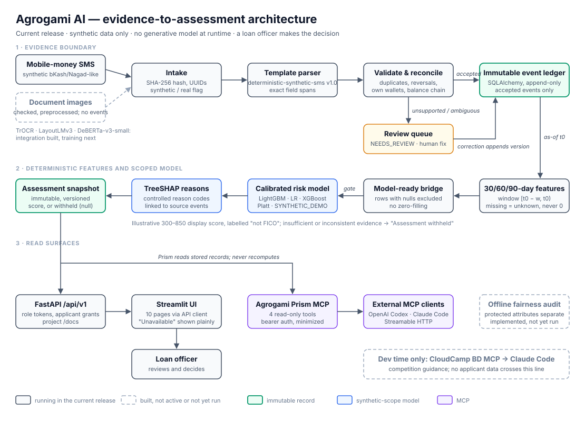

<div align="center">

### Agrogami AI

**Credit built on evidence.**

Traceable underwriting from the financial records traditional credit systems ignore.

<br />

[](https://agrogami.jmmn.tech)
[](https://youtu.be/DRZB9UrpXwc)
[](https://agrogami.jmmn.tech/docs)
[](https://github.com/ekadaedalus/agrogami-ai/tags)
[](pyproject.toml)
[](docs/build-status.md)
[](LICENSE)

<sub>[Live demo](https://agrogami.jmmn.tech) · [Video](https://youtu.be/DRZB9UrpXwc) · [Docs](https://agrogami.jmmn.tech/docs) · [API reference](https://agrogami.jmmn.tech/api/docs) · [Technical reference](docs/technical-reference.md) · [Issues](https://github.com/ekadaedalus/agrogami-ai/issues)</sub>

<br />



</div>

Agrogami AI turns mobile-money records into a traceable financial-evidence ledger and an explainable, calibrated risk assessment for people with little or no formal credit history. Every number traces back to the message it came from, and when the evidence is not good enough, Agrogami withholds the score instead of guessing.

It is built for Bangladesh's micro-enterprises: the furniture workshop or market stall with years of steady bKash and Nagad activity but no bureau file. A loan officer makes the decision; Agrogami shows the evidence and the reasons.

- **Every number has a source.** Each accepted event keeps its source hash, the exact character span it was read from, the parser version, its validation state and its correction history.
- **Rules verify before models score.** Duplicate SMS count once, reversals cancel the payment they reverse, and transfers between the applicant's own wallets are never counted as income.
- **Missing is unknown, never zero.** Features over 30, 60 and 90 days keep gaps visible; a row with a missing feature is excluded from the model rather than zero-filled.
- **It refuses to guess.** Insufficient or inconsistent evidence returns `INSUFFICIENT_EVIDENCE` or `NEEDS_REVIEW` with a null score, never a low one.
- **Scores come with reasons.** Calibrated LightGBM with TreeSHAP reasons linked to the events they came from, and a 300–850 display score labelled "project-specific; not FICO".
- **Any AI client can inspect it, none can change it.** Agrogami Prism is a read-only, authenticated MCP server over the same evidence and assessments.

> [!NOTE]
> All data in this repository and in the live demo is **synthetic**. Model results are a synthetic recovery test, not validated borrower underwriting. See [Responsible use](#responsible-use).

## Try it

Open **[agrogami.jmmn.tech](https://agrogami.jmmn.tech)**. Applicant data needs an access code: competition judges will find a read-only judge code in the submission. Paste it into **Developer settings → Demo credential** in the sidebar, then pick an applicant:

- **Rahim**, a synthetic furniture-workshop owner: 328 messages across two wallets, scored at a 3.89% modelled risk (display score 658), with the reasons behind it.
- **The abstention demo**: one verified inflow and unknown coverage, so the assessment is withheld.

Project documentation is public at [/docs](https://agrogami.jmmn.tech/docs) and the API reference at [/api/docs](https://agrogami.jmmn.tech/api/docs).

## Why Agrogami

Banks can only judge what they can measure. Micro-enterprises keep their financial lives in mobile-money messages, receipts and handwritten khatas, so a lender sees no file at all, and a creditworthy borrower is turned away.

Turning those records into credit evidence is harder than reading them:

- **An extraction mistake becomes a financial mistake.** One extra digit changes an amount tenfold.
- **The same money appears more than once.** Duplicate SMS, a receipt and its matching message, and transfers between a person's own wallets all inflate income if counted naively.
- **Gaps look like bad behaviour.** Incomplete history is easily mistaken for non-payment, and aggregation makes uncertain evidence look precise.

Agrogami puts a validated evidence boundary between unstructured records and the score: nothing reaches the model until it has been parsed, reconciled, accepted and linked to its source.

## How it works

**Read → Verify → Measure → Score**

| Stage | What happens |
|---|---|
| **Read** | Mobile-money SMS are parsed by a strict, versioned template parser (`deterministic-synthetic-sms` v1.0) that records the character span of every field. Unsupported messages go to review, never to a guess. |
| **Verify** | Validation checks required fields, duplicate transaction IDs, reversals, wallet ownership and running-balance continuity. Accepted events enter an immutable ledger; corrections append new versions with a reviewer and a reason. |
| **Measure** | Deterministic 30/60/90-day features over the window before the assessment: external cash flow, inflow variability, bill-payment punctuality, liquidity where balances are attested, activity and evidence coverage. |
| **Score** | Calibrated LightGBM (with logistic regression and XGBoost as benchmarks) produces a modelled risk, TreeSHAP reasons and an immutable assessment snapshot that records every evidence version, schema and model it used. |

The same records are served three ways, all through one application service: a Streamlit workbench, a versioned FastAPI (`/api/v1`) and the Agrogami Prism MCP server.

## Results

Trained on a seeded population of 2,000 synthetic borrowers (`synthetic-population-v1`, 362,018 messages) built through this same pipeline, with default labels from a published rule ([data card](data/synthetic/DATA_CARD.md)). Calibrated with sigmoid (Platt) scaling on a separate split; tested on 400 held-out borrowers (62 defaults).

| Model | AUC | Brier |
|---|---|---|
| **LightGBM (primary)** | **0.7487** | **0.1133** |
| Logistic regression (baseline) | 0.7437 | 0.1142 |
| XGBoost (challenger) | 0.7441 | 0.1147 |
| *Generating rule (ceiling)* | *0.8032* | — |

These numbers measure how much of a known synthetic rule the pipeline recovers. They are **not** real-world predictive performance.

**Robustness, shown on synthetic data:**
- **Abstention:** one verified inflow with unknown coverage gives "Assessment withheld — insufficient evidence" and no score.
- **Perturbation:** turning one of Rahim's Tk 500 receipts into Tk 5,000, with the reported balance unchanged, is flagged `BALANCE_INCONSISTENCY` and the score is withheld (`python -m scripts.perturbation_check`).

## Features

### Evidence

| Capability | Description |
|---|---|
| SMS intake | Single SMS, or a CSV bulk upload of up to 500 synthetic rows, each through the same parser and validation |
| Document intake | Raster images are checked for size, legibility and orientation; line regions keep their coordinates |
| Immutable ledger | Append-only SQLAlchemy storage of sources, candidates, events, corrections, feature snapshots and assessments |
| Reconciliation | Duplicates, reversals, own-wallet transfers, cash-in/out and unsettled credit sales handled by explicit rules |
| Provenance | SHA-256 source hash, text span or image region, parser version and validation state on every event |

### Assessment

| Capability | Description |
|---|---|
| Scoped models | Every model artefact declares `SYNTHETIC_DEMO`, `PUBLIC_DATASET_BENCHMARK`, `REAL_LINKED_OUTCOME_EXPERIMENT` or `UNTRAINED`; synthetic-scope scores are always `ILLUSTRATIVE` |
| Calibration | Platt or isotonic calibration on a split disjoint from training |
| Explanations | Interventional TreeSHAP on the raw margin, rendered as controlled reason codes linked to evidence |
| Abstention | `NEEDS_REVIEW` and `INSUFFICIENT_EVIDENCE` keep the score null |
| Fairness audit | Group TPR/FPR, selection and abstention rates with Wilson intervals; protected attributes are offline audit inputs only (implemented, not yet evaluated) |

### Surfaces

| Capability | Description |
|---|---|
| Streamlit workbench | Ten pages: Overview, Applicant Evidence, Evidence Review, Event Ledger, Financial Profile, Assessment, Explanation, Fairness & Evaluation, Audit Trail, Documentation |
| REST API | Versioned `/api/v1` with viewer, reviewer and admin roles and per-applicant grants in deployment mode |
| Project docs | Allowlisted, escaped rendering of the repository documentation at `/docs` |
| Agrogami Prism (MCP) | Four read-only tools (`get_evidence_ledger`, `get_assessment_snapshot`, `get_explanation_factors`, `get_fairness_audit`) over Streamable HTTP with bearer authentication; recorded calls from OpenAI Codex and Claude Code in [docs/evidence](docs/evidence/mcp-invocations.md) |

## Quick start

Tested on **Python 3.14.8, Windows**. From PowerShell in the repository root:

```powershell
python -m venv .venv
.\.venv\Scripts\python.exe -m pip install --only-binary=:all: -e ".[test,local,trees,fairness]"
Copy-Item .env.example .env
.\.venv\Scripts\python.exe -m scripts.build_demo     # seeded synthetic population, models, Rahim and the abstention applicant
.\scripts\run_demo_api.ps1                           # API on http://127.0.0.1:8000
.\scripts\run_ui.ps1                                 # UI on http://127.0.0.1:8501 (second terminal)
```

Run the tests with `.\.venv\Scripts\python.exe -m pytest -q` (480 pass offline, no model downloads). Prism, tokens, deployment mode, the public tunnel and Docker are covered in the [technical reference](docs/technical-reference.md).

## Project layout

```
src/agrogami/    contracts, storage, extraction, validation, features, risk, calibration,
                 explainability, fairness, application service, API, UI and MCP server
tests/           unit, integration and adversarial tests (480 default)
scripts/         demo build, training, perturbation check, run and verification helpers
data/synthetic/  seeded synthetic population, splits, metrics and data card
docs/            architecture, data contract, feature dictionary, evaluation protocol,
                 responsible AI, limitations, claims register and MCP evidence
```

## Roadmap

- **Perception:** a consented, annotated message and khata dataset; fine-tune DeBERTa-v3-small for SMS and evaluate TrOCR and LayoutLMv3 (adapters are built and tested; no checkpoint is trained yet).
- **Bangla khata reading.**
- **A backtest on a real loan book**, then a **live lender pilot**. Pilot targets: under 10 minutes per assessment, a full audit trail, and 250 borrowers with a first microfinance partner.

## Responsible use

- **Synthetic only.** No real borrower, khata, utility-bill or provider data is used. The SMS templates are invented look-alikes; no live bKash, Nagad or bank integration is claimed.
- **Not a lending decision.** Outputs are illustrative research results, and a loan officer decides. The 300–850 score is not FICO or bureau-equivalent.
- **No fairness or validity claim.** Fairness metrics are implemented but not evaluated; real predictive and fairness claims need representative, consented data linked to mature repayment outcomes.
- **No generative model at runtime.** Every credit-relevant value comes from task-specific models and deterministic code; development used OpenAI Codex and Claude under the [`AGENTS.md`](AGENTS.md) contract.
- **Claim discipline.** Every claim maps to code, a test, an artefact or a stated limitation in the [claims register](docs/claims-register.md). See also [limitations](docs/limitations.md).

## Contributors

<a href="https://github.com/ekadaedalus/agrogami-ai/graphs/contributors">
  
</a>

Built for the **Idea to Unicorn** track of the International AI Builders Congress 2026.

## License

Apache License 2.0. See [LICENSE](LICENSE).

---

<div align="center">
<sub>

[Live demo](https://agrogami.jmmn.tech) · [Video](https://youtu.be/DRZB9UrpXwc) · [Docs](https://agrogami.jmmn.tech/docs) · [Technical reference](docs/technical-reference.md) · [Apache 2.0](LICENSE)

</sub>
</div>
